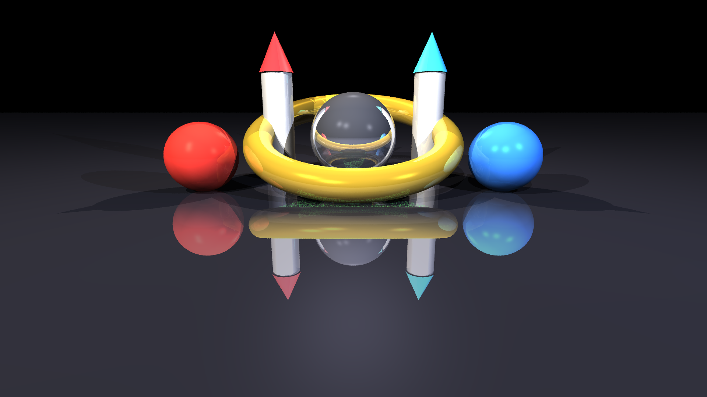
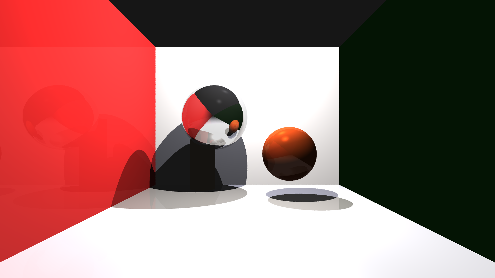
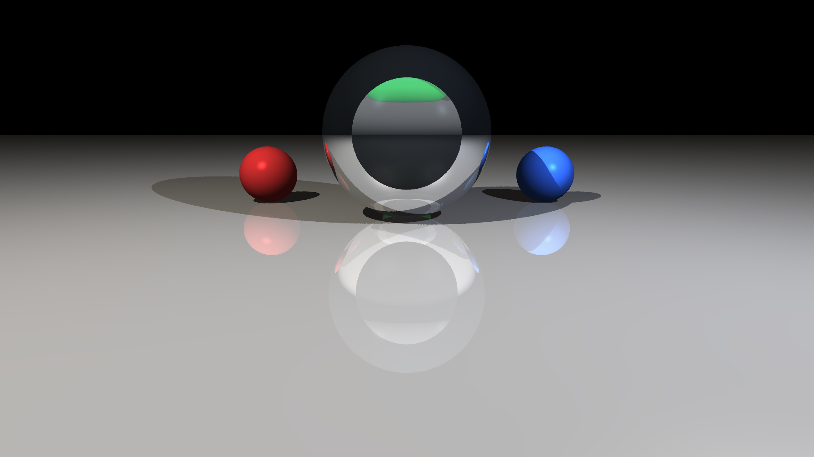
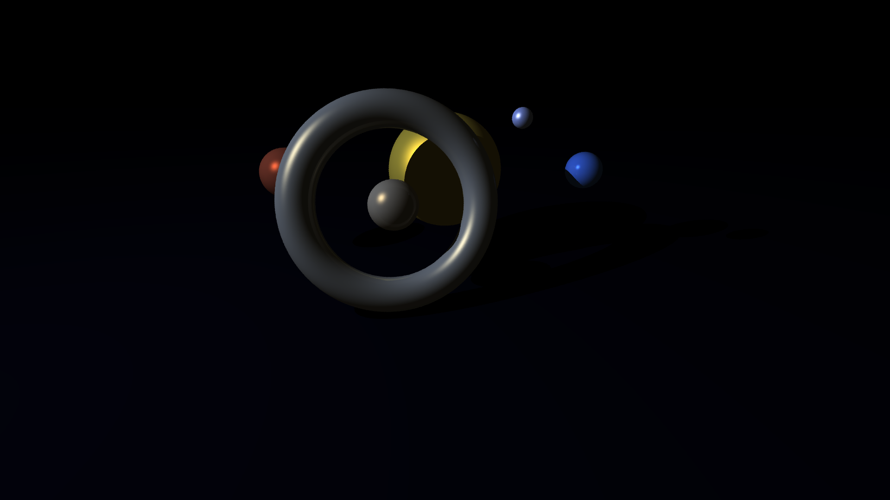
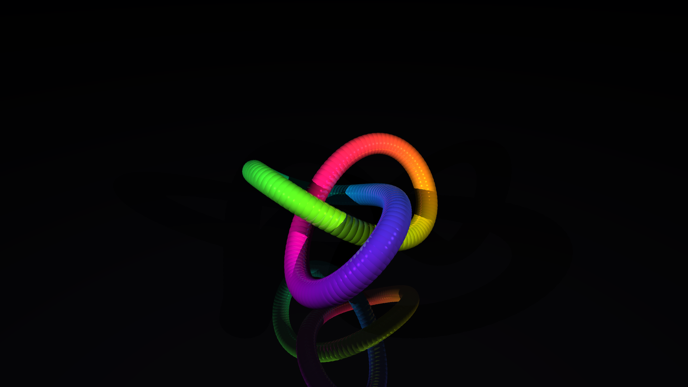
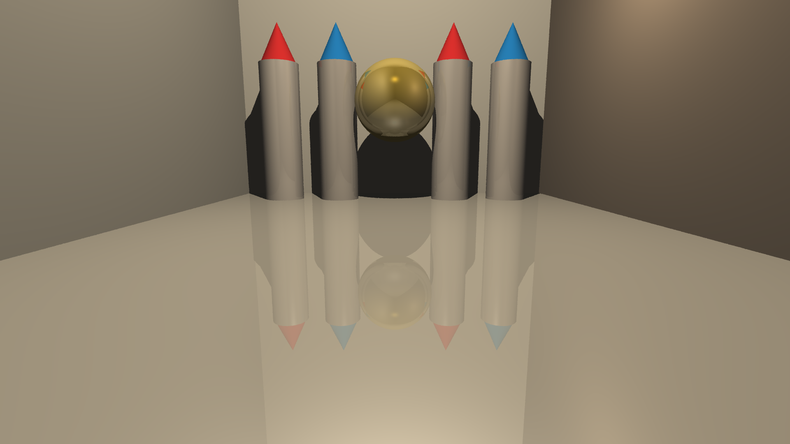

# RayTracer

[](https://github.com/Ridwane777/raytracer/actions/workflows/build.yml)

A C++20 ray tracer that renders scene files to `.ppm` images, with primitives and lights loaded as dynamic `.so` plugins.

<table>
  <tr>
    <td></td>
    <td></td>
    <td></td>
  </tr>
  <tr>
    <td></td>
    <td></td>
    <td></td>
  </tr>
</table>

## Architecture & design patterns

The engine follows SOLID principles and relies on four design patterns:

- **Factory** (`PrimitiveFactory`, `LightFactory`): loads `.so` plugins at runtime. The core has no knowledge of which primitives or lights exist.
- **Decorator** (`Transform`): handles spatial transformations. Each primitive is created at the origin (0,0,0) and wrapped in a `Transform` that applies a 4x4 transformation matrix.
- **Composite** (`PrimitiveList`): treats a collection of `IPrimitive` objects as a single one, so a ray is cast against the whole scene with one `hits()` call.
- **Builder** (`SceneBuilder`): builds the final `Scene` step by step from the data extracted by `SceneParser`.

## Features

### Primitives
- Sphere, plane, cylinder, cone (dynamic plugins)
- Triangle (`triangle.so`), using plane-polygon intersection
- Torus (`torus.so`), solved analytically as a quartic equation
- Wavefront `.obj` models, triangulated on the fly

### Transformations
- Translation, rotation (`rotationX`, `Y`, `Z`), scale and shear
- Combined and inverted 4x4 matrices, applicable to any primitive without changing its code

### Lighting
- Ambient, directional and point lights (`plugins/point/PointLight`, with falloff)
- Unlimited number of lights, contributions summed
- Colored (RGB) lights: final color is the product of object and light colors
- Drop shadows via shadow rays
- Phong reflection model (ambient, diffuse, specular)

### Materials
- Flat RGB color
- Transparency (alpha blending)
- Refraction (Snell's law, refractive indices, total internal reflection)
- Reflection (mirror), with bounce depth limited by `_maxDepth`

### Rendering
- Antialiasing by supersampling with random sub-pixel offsets
- Recursive rendering engine

### Display & interface
- Scenes configured through text files (libconfig)
- Output as `.ppm` (P3) images
- Errors reported on `stderr`, `--help` usage

## Build & usage

### Requirements
- A `C++20` compiler
- `cmake` (>= 3.17)
- `libconfig++` (`sudo dnf install libconfig-c++-devel` or `sudo apt install libconfig++-dev`)

### Build

```bash
cmake -B build -S .
cmake --build build
```

### Run

```bash
# Render the test scene
./raytracer scenes/simple_scene.cfg
```

The image is saved as `output.ppm`.

## Scene files

Scenes are libconfig text files. See the files in `scenes/` for examples.

## Documentation

- [Architecture](docs/architecture.md)
- [Transformations](docs/transformations.md)
- [Math formulas](docs/formulas.md)
- [Camera and math fixes](docs/camera-math-fixes.md)
- [Bug fixes](docs/bug-fixes.md)

## Author

Ridwane777
